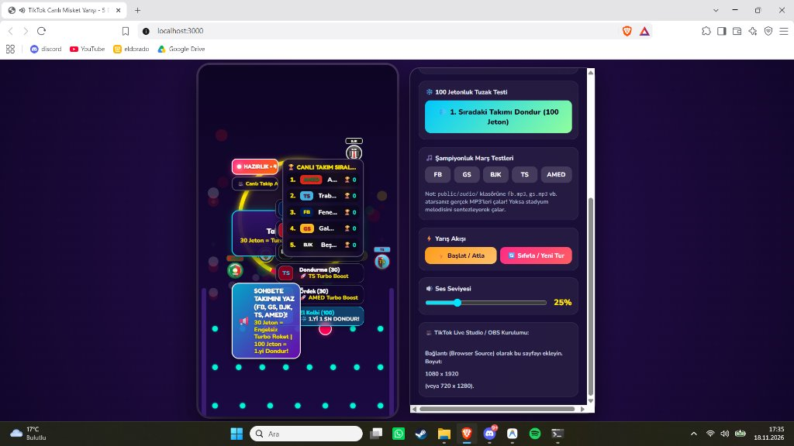
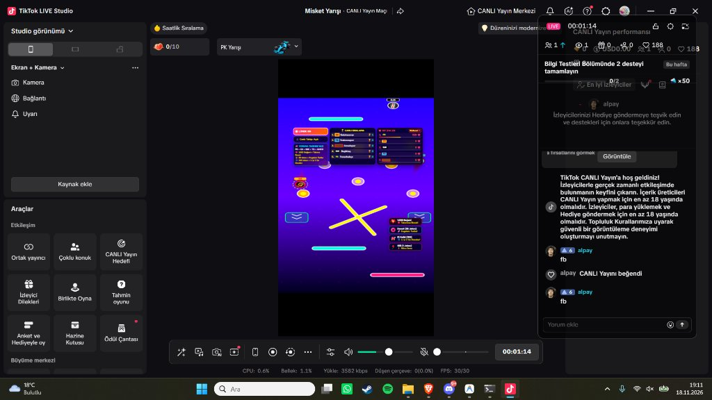
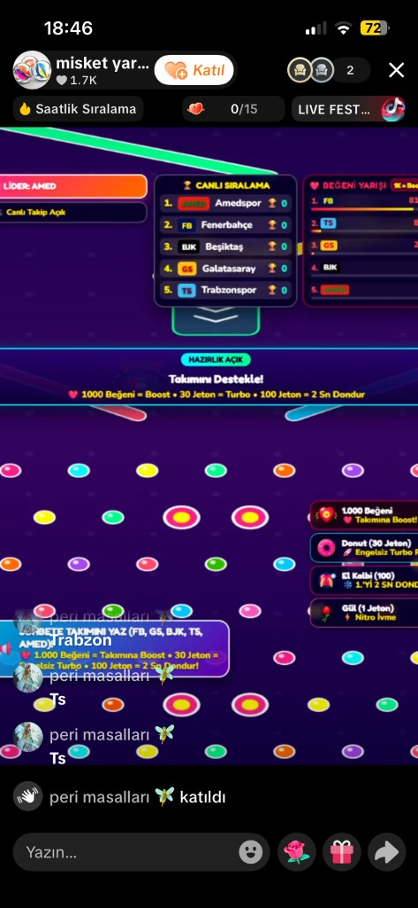

# ⚽ TikTok Canlı Yayın Misket Yarışı — 5 Büyük Takım Kapışması


TikTok Canlı Yayınları (**TikTok LIVE Studio** ve **OBS Studio**) için özel olarak geliştirilmiş, izleyicilerin **yorum**, **beğeni** ve **hediyelerle** gerçek zamanlı olarak **5 büyük futbol takımını (`FB`, `GS`, `BJK`, `TS`, `AMEDSPOR`)** yarıştırdığı interaktif 9:16 dikey misket yarışı oyunu.

---

## 📸 Ekran Görüntüleri

| 🎛️ Yayıncı Kontrol Paneli & Sahne | 🎥 TikTok LIVE Studio Görünümü | 📱 Mobil Canlı Yayın Ekranı |
| :---: | :---: | :---: |
|  |  |  |

---

## ✨ Öne Çıkan Özellikler

- **⚽ 5 Büyük Takım & Gerçekçi Dönen Armalı Misketler:**
  - **Fenerbahçe (`FB`)**, **Galatasaray (`GS`)**, **Beşiktaş (`BJK`)**, **Trabzonspor (`TS`)** ve **Amedspor (`AMED`)** özel vektörel armaları, takım renkleri ve neon efektleriyle pistte gerçek fizik kurallarıyla dönerek yarışır.
- **💬 Sohbetten Takım Seçimi:**
  - İzleyiciler canlı yayın sohbetine `FB`, `GS`, `BJK`, `TS` veya `AMED` yazdığı anda sistem kullanıcıyı o takıma bağlar (`+20 ❤️` takım beğeni bonusu ve anlık ivme verir).
- **❤️ Canlı Beğeni Yarışı (`1.000 Beğeni = Boost`):**
  - Takım seçen izleyicinin attığı her beğeni gerçek zamanlı olarak tuttuğu takımın hanesine yazılır.
  - Sağ üstteki **`❤️ BEĞENİLER (1K=Boost⚡)`** tablosunda takımların toplam beğenileri ve 1.000 barajına kalan ilerleme çubuğu canlı güncellenir.
  - Her **1.000 beğeni** barajını aşan takım otomatik olarak **Ateşli Boost** kazanır!
- **🎁 Gerçek TikTok Hediye & Jeton Güçleri:**
  - **1–29 Jeton (`🌹 Gül` vb.):** Tuttuğun takıma sesli ve alev efektli **`⚡ Nitro İvme`** verir.
  - **30–99 Jeton (`🍩 Donut` vb.):** Tuttuğun takıma 3.5 saniye boyunca tüm engellerin içinden hızla geçen **`🚀 Engelsiz Turbo Roket`** açar!
  - **100+ Jeton (`🫶 El Kalbi` vb.):** Yarışta o an **1. sırada giden lider takımı 2 tam saniye buz kütlesi içinde dondurur (`❄️ 2 Sn Dondur`)**!
- **🎵 Stadyum Maç Müziği & Şampiyonluk Marşları (RAM Önyüklemeli Tek Kanal Ses Motoru):**
  - Yarış ve hazırlık esnasında arka planda kesintisiz stadyum maç müziği (`bg_match.mp3`) çalar.
  - Bir takım finiş çizgisini ilk geçtiğinde maç müziği otomatik susar ve kazanan takımın **orijinal şampiyonluk marşı** (`fb.mp3`, `gs.mp3`, `bjk.mp3`, `ts.mp3`, `amed.mp3`) çalar; yeni tur başladığında maç müziği kaldığı yerden devam eder.
- **🗺️ 3 Farklı 60 Saniyelik Dev Harita (Otomatik Döngülü):**
  1. **Harita 1 — Şeker Fabrikası:** Plinko & Mantarlar ➔ Değirmen Çarklar ➔ Kayar Platformlar
  2. **Harita 2 — Zikzak Kanyonu:** Zikzak Şelalesi ➔ Çift Köprü & Mikser ➔ Makas Kapılar & Sarkaç
  3. **Harita 3 — Kaos Arenası:** Flipper & Bumper Arena ➔ Dev Çark Labirenti ➔ Kum Saati & Tampon Duvarı
- **🔄 Web Worker Arka Plan Saati & Sıfır Gecikmeli Canlı Senkronizasyon:**
  - Yayıncı tarayıcı sekmesini alta alsa bile Web Worker saati fiziği 60 FPS hızında kesintisiz çalıştırır ve TikTok LIVE Studio (`?obs=1`) ekranına anlık senkronize eder.

---

## 🎮 Hediye & Etkileşim Tablosu

| Etkileşim / Hediye | Değer | Oyun İçi Etkisi |
| :--- | :---: | :--- |
| 💬 **Sohbete Takım Yazma** (`FB`, `GS`, `BJK`, `TS`, `AMED`) | Ücretsiz | İzleyiciyi takıma bağlar + Küçük İtme + `+20 ❤️` Beğeni |
| ❤️ **1.000 Takım Beğenisi** | 1.000 Beğeni | Takımın misketine **Ateşli Beğeni Boostu** verir |
| 🌹 **Gül / Küçük Hediyeler** | 1 – 29 Jeton | Takıma **⚡ Nitro İvme** + Alev Efekti verir |
| 🍩 **Donut / Orta Hediyeler** | 30 – 99 Jeton | Takıma 3.5 sn **🚀 Engelsiz Turbo Roket (Hayalet Modu)** açar |
| 🫶 **El Kalbi / Büyük Tuzak** | 100+ Jeton | **❄️ 1. Sıradaki Lider Takımı 2 Saniye Dondurur!** |

---

## 🚀 Kurulum ve Çalıştırma

### 1. Gereksinimler
- [Node.js](https://nodejs.org/) (v18 veya üzeri)

### 2. Paketleri Yükleme
```bash
npm install
```

### 3. Tek Tıkla TikTok LIVE Studio Başlatıcı (Windows)
Proje klasöründeki **`BASLAT_TIKTOK_STUDIO.bat`** dosyasına çift tıklayın:
1. Yerel sunucu `http://localhost:3000` adresinde başlar ve kontrol paneli tarayıcınızda açılır.
2. **TikTok LIVE Studio** için güvenli HTTPS Cloudflare tünel bağlantısı (`https://xxxx.trycloudflare.com?obs=1`) otomatik oluşturulur ve **panonuza (Clipboard) kopyalanır**.
3. **TikTok LIVE Studio** ➔ **Kaynak Ekle** ➔ **Bağlantı (Link)** kısmına `Ctrl + V` ile yapıştırın ve çözünürlüğü **`1080 x 1920`** (veya `720 x 1280`) olarak ayarlayın.

### Manuel Başlatma
```bash
npm start
```
- **Yayıncı Kontrol & Test Paneli:** `http://localhost:3000`
- **OBS / Live Studio Tam Ekran Yayın Modu:** `http://localhost:3000/?obs=1`

---

## 📁 Proje Yapısı

```text
├── public/
│   ├── audio/               # Takım şampiyonluk marşları (fb, gs, bjk, ts, amed) ve maç müziği (bg_match.mp3)
│   ├── images/              # Vektörel hediye ikonları (donut.svg, hand_heart.svg, like_heart.svg, rose.svg)
│   ├── index.html           # 9:16 Yayın sahnesi ve Yayıncı Kontrol Paneli
│   ├── style.css            # Mobil güvenli alan uyumlu neon arcade arayüz tasarımı
│   └── game.js              # 60 FPS fizik motoru, 3 harita, ses motoru ve Socket.IO senkronizasyonu
├── docs/
│   └── screenshots/         # Proje ekran görüntüleri
├── server.js                # Express + Socket.IO + tiktok-live-connector v2 sunucusu
├── launcher.ps1             # Otomatik HTTPS tünel ve pano kopyalayıcı script
├── BASLAT_TIKTOK_STUDIO.bat # Tek tıkla canlı yayın başlatıcı
└── package.json
```
